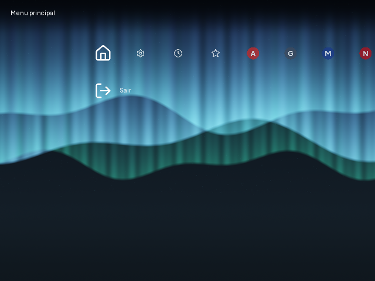
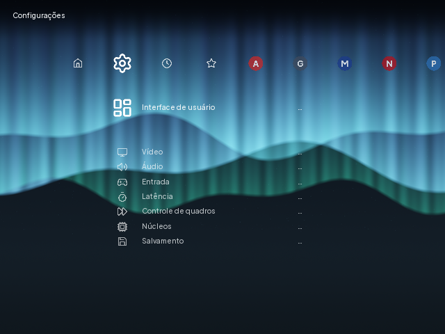
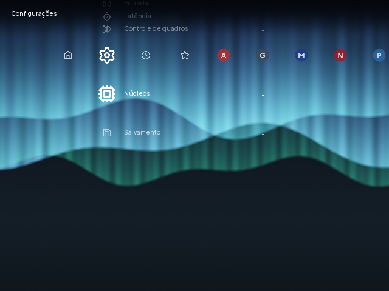
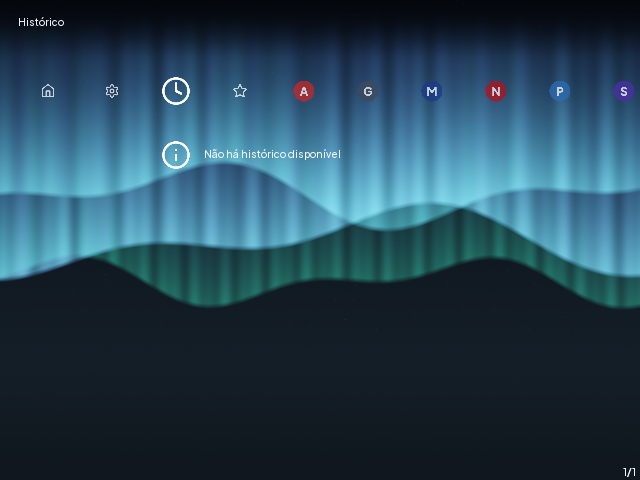
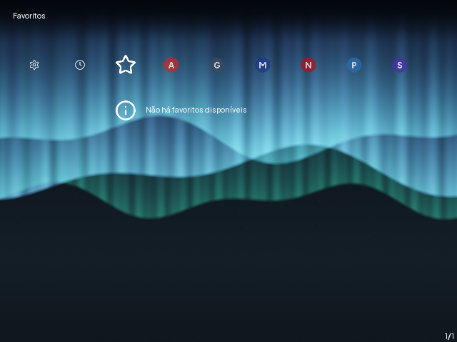
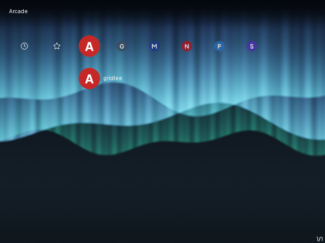
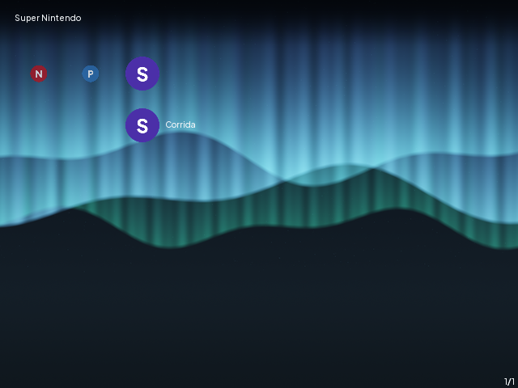

# Tema Lume no XMB

O menu do RetroArch usa o tema Lume: fundo Aurora 640x480, fonte Plus Jakarta Sans
Medium, ícone redondo com a inicial de cada sistema e ícones de interface Lucide.

- Fontes: `theme/lume/` (fontes, licenças, wallpaper master e `theme.json`).
- Gerador: `theme/lume/generate.py` (Pillow), empacotado como `retroarch-theme-lume`
  em `/usr/share/r36os/retroarch-assets/xmb/custom/`.
- Configuração: `/usr/share/r36os/retroarch-lume.cfg` (`--appendconfig`).

## Calibração a 640x480

Feita na VM (`tests/vm/capture_menu.py`, capturas por QMP `screendump`):

| Opção | Valor | Motivo |
|---|---|---|
| `xmb_scale_factor` | `100` | a 640x480 nenhum rótulo é cortado; o maior ("Gerenciamento de energia") cabia antes de ser ocultado, e os itens visíveis ficam com folga |
| `menu_font_color_*` | `242,245,247` (`#F2F5F7`) | contraste sobre a parte escura do Aurora e sobre a faixa do topo |
| `xmb_menu_color_theme` | `10` (wallpaper) | sem ele o XMB do 1.22 ignora um fundo chamado `bg.png` e desenha o gradiente |
| `xmb_theme` | `6` (custom) | no 1.22 o tema `custom` é o 7º do enum; `7` seria `retrosystem` |
| `user_language` | `7` | menu em português do Brasil |

Achados do RetroArch 1.22 que o tema precisa respeitar:

- O XMB carrega **todas** as texturas de `xmb_texture_path()`. Se faltar uma só, ele marca
  `assets_missing` e não desenha nenhum ícone nem o fundo. Por isso o `theme.json` mapeia os
  145 nomes (os que não têm um ícone próprio usam um ícone Lucide genérico), e o teste
  `tests/unit/test_theme.py` confere a lista.
- Os ícones de sistema se chamam como a lista de jogos (`<Nome>.png` e `<Nome>-content.png`).

## Capturas

| Tela | Captura |
|---|---|
| Menu principal (só "Sair") |  |
| Configurações (itens ocultos não aparecem) |  |
| Configurações, fim da lista |  |
| Favoritos |  |
| Histórico |  |
| Sistema (Arcade) |  |
| Sistema (Super Nintendo) |  |
| Lista de jogos |  |

As capturas saem da VM sem virgl (o RetroArch desenha o mesmo XMB por software), porque
o QMP `screendump` não lê a saída GL com o driver NVIDIA proprietário do host.

## Menu enxuto

Visíveis: abas dos sistemas com jogos, Histórico, Favoritos, Configurações e o menu
principal só com "Sair". Ocultos: atualizadores (online e de cores), importar
conteúdo, explorar, netplay, música, vídeo, imagens, carregar core/conteúdo/disco,
informações, ajuda, reiniciar e desligar pelo RetroArch. Nas configurações ficam Interface,
Vídeo, Áudio, Entrada, Latência, Controle de quadros, Núcleos e Salvamento.
